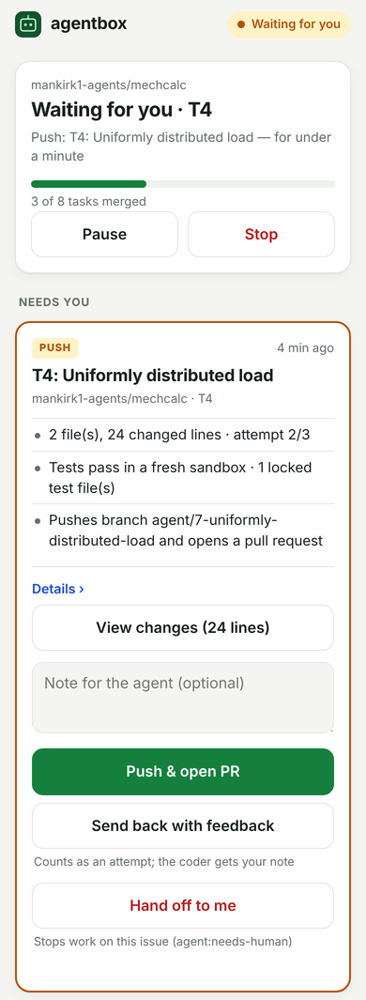

# agentbox

A local, hands-off coding agent. Give it a one-page project outline and it:

1. writes a technical specification and a dependency-ordered task plan,
2. creates a private GitHub repository with one issue per task,
3. works through the issues one at a time — tests first, then the implementation, in a
   throwaway Docker sandbox — and
4. opens a pull request for each, has a second model review it, waits for CI, and merges.

When it cannot finish an issue after three attempts it labels it `agent:needs-human`,
explains why on the issue, and moves on to work that does not depend on it. It runs
unattended overnight and posts a report in the morning, or, in **manual mode**, waits for
your OK on your phone before each plan, task, push and merge.

Everything runs locally on open-weight models. Claude helped build and set it up; the
nightly runs do not use Claude.

## How it fits together

```
 outline.md ──► agentctl (orchestrator, plain Python state machine)
                  │
                  ├── llama-swap  ── qwen-coder      Qwen3.6-35B-A3B   plans + writes code
                  │   (llama.cpp)  └ gemma-reviewer  Gemma 4 26B-A4B   critiques plans, reviews PRs
                  │
                  ├── Docker sandbox per attempt (no internet except the allow-list proxy,
                  │   read-only GitHub MCP server, non-root, capabilities dropped)
                  │
                  └── GitHub (separate agent organization): repo, issues, PRs, Actions CI
```

Safety rules built into the design:

- **Only orchestrator code writes to GitHub.** Models get a read-only token, used through
  the official GitHub MCP server to read issues and PRs.
- **Model-written code only runs in containers** on an internal Docker network whose only
  exit is a proxy that allows PyPI, npm and the GitHub API.
- **The orchestrator runs the tests itself** in a fresh container; locked tests, `.github/`,
  `AGENTS.md` and `SPEC.md` cannot be changed by the model; a different-family model
  reviews every diff.
- **You decide how much it may do alone.** In manual mode nothing reaches GitHub without
  your tap in the phone panel; auto mode can still ask before chosen steps (e.g. merges).
- **Ollama guard:** before a run and before every task, agentctl checks for Ollama on
  Windows, in WSL and in Docker, stops it (default), and restarts it when the run ends.
  `windows/Start-AgentRun.ps1` does the same on the Windows side.

## This machine

| | |
| --- | --- |
| Laptop | Dell XPS 15 9530 — i7-13620H (6P + 4E cores, 16 threads), 32 GB DDR5-4800 |
| GPU | Intel Arc A370M — **not used** (no CUDA; Vulkan via WSL2/Docker is unreliable) |
| Profile | `32gb-cpu` → `llama-swap/profiles/32gb-cpu.yaml`, image `ghcr.io/mostlygeek/llama-swap:cpu` |
| Models | `Qwen3.6-35B-A3B-UD-IQ4_XS.gguf` (17.7 GB), `gemma-4-26B-A4B-it-UD-IQ4_XS.gguf` (13.6 GB) |
| WSL memory | 26 GB, 14 processors (`windows/wslconfig.example` → `C:\Users\<you>\.wslconfig`) |

Expect CPU inference to be slow by cloud standards: `agentctl doctor` measures the real
speed. The defaults are set for that: coder reasoning off, 90-minute attempt limit, one
task at a time, 8-hour nightly budget.

## Where things live (inside WSL)

| Path | Contents | In git? |
| --- | --- | --- |
| `~/KIWI/agentbox/` | This folder: code, scripts, profiles, outlines | yes |
| `~/KIWI/agentbox/config.yaml` | Your settings (copied from `config.example.yaml`) | no |
| `~/KIWI/agentbox/.env` | GitHub tokens, model folder, compose settings | no |
| `~/agentbox-runtime/models/` | The GGUF model files (~31 GB) | no |
| `~/agentbox-runtime/{projects,repos,work,logs,reports,inbox}/` | Project state, clones, sandbox copies, logs, morning reports, queued outlines | no |
| `~/agentbox-runtime/STOP` | Exists only while a stop is requested | no |

Runtime state is deliberately outside the repository, so nothing you do in git (switching
branches, `git clean`) can touch models or project history.

## Setup

The full step-by-step guide (with troubleshooting for every step) is the
**agentbox setup guide** document. The short version, inside WSL2 Ubuntu 24.04 with
Docker Desktop's WSL integration on:

```bash
sudo apt-get update && sudo apt-get install -y python3-venv python3-pip git curl jq gh
gh auth login                                   # once, to clone the private KIWI repo
git clone https://github.com/Mankirk1/KIWI-public.git ~/KIWI
cd ~/KIWI/agentbox
bash scripts/setup-wsl.sh && source ~/.bashrc   # venv, agentctl, config files, runtime folder
nano .env                                       # GH_ADMIN_TOKEN and GH_AGENT_TOKEN
nano config.yaml                                # github.owner = your agent organization
scripts/select-profile.sh 32gb-cpu
scripts/download-models.sh                      # ~31 GB, resumable
scripts/build-worker.sh                         # sandbox image
docker compose up -d                            # llama-swap + egress proxy
agentctl doctor                                 # every line should say OK
agentctl plan-only outlines/mechcalc.md         # dry run: spec + plan, no GitHub writes
# phone panel, in Windows PowerShell: powershell -ExecutionPolicy Bypass -File .\Register-PanelTask.ps1 -Tailscale
agentctl pair                                   # sign your phone in (see "Control from your phone")
agentctl mode manual                            # approve the first run step by step
agentctl new outlines/mechcalc.md               # the first real project
agentctl mode auto                              # once you trust it; then schedule nights (windows/)
```

**Where this stands (2026-10-11):** all code is merged and tested on GitHub (CI), but nothing
has run on the laptop yet. The order from here is: guide steps 1–4 (you: Windows, Docker,
GitHub tokens, Ubuntu packages) → step 5 (a Claude Code WSL session follows
[`CLAUDE.md`](CLAUDE.md) Phase C: install, models, doctor, dry run) → step 8 (you: Tailscale
and phone pairing) → step 6 (first run in Manual mode) → step 7 (nightly task).

## Commands

| Command | What it does |
| --- | --- |
| `agentctl doctor [--quick]` | Checks host, Ollama, Docker, models (load, speed, tool calling), GitHub tokens, sandbox isolation |
| `agentctl plan-only OUTLINE.md` | Spec + plan only, written to `~/agentbox-runtime/projects/<repo>/` |
| `agentctl new OUTLINE.md [--name N] [--use-plan DIR]` | Create repo + issues, then work until done / budget / STOP; `--use-plan` reuses a `plan-only` folder's spec, plan and checks |
| `agentctl continue REPO` | Resume; picks up issues you labelled `agent:todo` and your comments |
| `agentctl continue-all` | Start queued outlines, then resume every project (used by the nightly task) |
| `agentctl queue OUTLINE.md` | Queue an outline for the next `continue-all` |
| `agentctl extend REPO "request"` / `--file F` | Plan new issues for an existing project and work on them |
| `agentctl set-stack REPO --setup S --test T` | Fix a project's install/test commands |
| `agentctl status [REPO]` | Task status |
| `agentctl stop` / `unstop` | Ask a running agent to stop at its next checkpoint / allow runs again |
| `agentctl clean [--days N]` | Delete old sandbox work copies |
| `agentctl serve` | Run the phone control panel (see below) |
| `agentctl pair [--logout-all]` | One-time code to sign a phone in / sign every phone out |
| `agentctl mode [auto\|manual]` | Show or switch how much the agent asks you |
| `agentctl pause` / `resume` | Hold the agent at its next checkpoint / let it continue |
| `agentctl ask` / `answer ID CHOICE [--note T]` | The same questions as the panel, from a terminal |
| `agentctl sentinel [REPO] [--all]` | Replay the watchdog rules over everything a project's runs recorded |
| `agentctl checks REPO [--regenerate]` | List the project's outline checks (or write them again from the outline) |
| `agentctl digest [--hours N]` | The latest digest: what the last command (night) merged or left for you |

### Outline checks and the mutation check

Tests written from acceptance criteria can agree with a mistake: in the first runs a wrong value
was locked into the tests and the code was bent to match it, and later a CLI passed all its tests
while printing tracebacks the outline forbids. So at planning time the planner model also turns the
outline into **executable checks** (`agentbox/oracle.py`): values (`Rectangle(b=0.05, h=0.1).area`
equals the outline's formula applied to those inputs), expected errors, and commands with their exit
status and output shape (one JSON object, readable text, one line on stderr). A deterministic
validator refuses any expected number that is not in the outline or the check's own inputs, so a
check never contains arithmetic the model did itself. You see them at the Plan gate; they live in
`~/agentbox-runtime/projects/<repo>/checks.json`, where you can fix one or set `"enabled": false`.

The coder gets its task's checks up front. After the tests pass, the checks run in the same sandbox
container; a failing check of this task, or of a finished one (a regression), sends the attempt back
like a failing test, and two identical failures in a row hand the task to you (the code or the check
is wrong). The same step reports imports of names that do not exist. Then the **mutation check**
plants small errors in the task's Python code (`+` → `-`, `<` → `<=`, constants changed) and reruns
the tests: the errors they don't catch are listed at the Push and Merge gates, on the PR and in the
merge record. It never blocks; it tells you where the tests are thin.

### Nights: guard rails and the morning digest

- `control.night.hours` (e.g. `"23:00-07:30"`): at night a question nobody answers within
  `question_timeout_min` is left for you (the PR stays open, or the task is skipped) and the run
  goes on with work that doesn't depend on it. Night notifications are silent, except Sentinel's
  high alerts (`wake_for_sentinel_high`).
- `workflow.ci.require_for_auto_merge` (on): a merge without you needs CI to pass; CI that never
  ran or timed out leaves the PR open.
- `budget.max_wall_hours`: set it below the nightly task's 9 h limit; no attempt starts unless
  it can finish before it, so Windows never kills a run halfway.
- At the end of every command a **digest** summarises it: merged PRs to check (size, attempts,
  review, CI, checks, mutants), tasks left for you with the reason, Sentinel's findings, minutes per
  task and what is queued next. It arrives as one notification, opens in the panel's Digest tab,
  and is saved in `~/agentbox-runtime/reports/digests/`.
- Tests locked in the tests phase are kept until the task merges, so a run that stops right after
  them doesn't throw them away (the Start gate offers "Start with new tests").

### Sentinel (watchdog)

During every run a rule-based watchdog reads what the run records - the coder's step-by-step
transcripts and the task history - and flags known failure patterns with the evidence that
triggered them: the coder questioning a locked test, repeated attempts without changes, edits to
`conftest.py` or pytest settings while tests are locked, installed commands missing from PATH,
repeated identical calls, very slow steps, context compactions and attempts running over 45 min.
Findings appear in the panel's activity feed; high-severity ones also reach the phone through
ntfy (`sentinel.notify`). Everything is also written to `control/sentinel.jsonl`. It uses no
model, takes no measurable CPU and never changes anything: deciding stays with you.

## Control from your phone



`agentctl serve` runs a small web app (no extra dependencies) that shows what the agent is
doing right now, every question waiting for you, the activity feed, per-project progress
and the live log. From it you can:

- **Switch Auto ⇄ Manual** at any time, even mid-run.
  - *Auto*: runs on its own; only the gates in `control.always_ask` wait for you.
  - *Manual*: waits at every gate in `control.manual_gates`:

    | Gate | When | Your choices |
    | --- | --- | --- |
    | Plan | before the repository and issues are created | Create repo & start · Re-plan with my notes · Cancel |
    | Start task | before the coder starts an issue | Start (a note becomes guidance for the coder) · Skip for now · Stop the run |
    | Review tests | after the tests are written from the acceptance criteria, before they are locked | Lock tests & implement · Rewrite tests with my notes · Hand off to me |
    | Push | before a branch is pushed and a PR opened (tests already pass) | Push & open PR · Send back with feedback · Hand off to me |
    | Merge | after review and CI, before merging | Merge · Send back with feedback · Leave PR for me |

    Every other push (the CI workflow, OUTLINE.md, a work-in-progress branch) also asks in
    manual mode. Three questions appear only when something went wrong, at the gate they belong to:

    | Question | When | Your choices (auto mode takes the first) |
    | --- | --- | --- |
    | The reviewer requested changes (merge gate) | the review blocks a PR | Send back to the coder · Overrule the reviewer · Send back with my notes · Leave PR for me |
    | Attempt made no changes (task gate) | an attempt ends without usable changes | Try again (optional note) · Hand off to me |
    | The coder says a locked test is wrong (tests gate) | the coder reports a locked test that contradicts SPEC.md/OUTLINE.md | Rewrite the tests · Keep the tests · Hand off to me (auto mode rewrites once per task) |

    Every note you give at any gate is kept with the task: the coder gets all of them on every
    later attempt (also after a restart), and the reviewer gets them too, together with the
    owner's outline (OUTLINE.md). Your notes and the outline win over the issue's criteria.
- **Read the diff** before approving, with the coder's summary, the review and CI result.
- **Pause / Resume / Stop.** Pause and Stop take effect at the next checkpoint (between
  steps; a coding attempt in progress finishes first). Time spent paused or waiting for you
  does not count against `budget.max_hours`.

Switching to Auto while a question is waiting approves it. With `notify.ntfy_url` set, each
question also arrives as a phone notification; tapping it opens the question in the panel.

### Reaching it from the phone: Tailscale

The panel listens on `127.0.0.1:8765` only. [Tailscale](https://tailscale.com) (free for
personal use) gives it an HTTPS address that only your own devices can open:

1. Install Tailscale on Windows and on the phone; sign in to both with the same account.
   In the Tailscale admin console, enable **MagicDNS** and **HTTPS certificates** (DNS page).
2. In Windows PowerShell, from the folder with the agentbox scripts:
   `powershell -ExecutionPolicy Bypass -File .\Register-PanelTask.ps1 -Tailscale` — starts the
   panel at every sign-in and prints the address (`https://<pc-name>.<tailnet>.ts.net`).
   (Windows blocks downloaded scripts by default; `-ExecutionPolicy Bypass` allows just this
   run.) `-Stop` stops the panel until the next sign-in, `-Remove` unregisters it.
3. Put that address in `config.yaml` as `control.public_url`.
4. In Ubuntu run `agentctl pair`, open the address on the phone and enter the 6-digit code.
   Add the page to the home screen for an app-like icon.

Sign-in uses a one-time code (10 minutes, 5 tries) exchanged for a 90-day session cookie;
only hashes are stored. `agentctl pair --logout-all` signs every phone out. The panel never
reads `.env` and redacts token-like strings from logs and diffs before showing them.

### Claude Code sessions on this repo

`KIWI/.claude/settings.json` makes Claude Code ask before `git push`, `gh pr merge` and
`gh repo create/delete`, in every permission mode (Bypass is disabled for this project).
A hook (`.claude/hooks/ask-before-publish.py`) catches the forms a text rule misses
(`git -C dir push`, `bash -c "git push"`, `gh api …/merge`). To answer those questions from
your phone, turn on Remote Control for the session (`/remote-control`, or in the desktop app
**Settings → Claude Code → Connect new sessions to Remote Control**) and, in `/config`,
**Push when actions required**; the question then appears in the Claude app.

## First project: mechcalc

[`outlines/mechcalc.md`](outlines/mechcalc.md) describes a beam-calculation library and
CLI (section properties, bending moment, stress, deflection, safety factor) with every
formula and material value spelled out, so the result is checkable against hand
calculations. It is headless, standard-library only and fully testable offline — a good
fit for a sandboxed agent on a CPU — and sized for roughly one night.
[`outlines/mechcalc-api.md`](outlines/mechcalc-api.md) is the follow-up change request
(a FastAPI service on top) for `agentctl extend`.

## Folder layout

```
orchestrator/agentbox/   state machine (loop.py), planner, reviewer, sandbox, git, GitHub API,
                         Ollama guard (guards.py), approval gates (control.py), phone panel
                         (panel.py + web/), doctor, CLI
worker/                  sandbox image + coding agent (tool loop, file/shell tools, GitHub MCP bridge)
llama-swap/              model-server profiles (32gb-cpu for this laptop; 16/32/64gb for NVIDIA) + model list
proxy/                   egress allow-list proxy (Squid) for the sandbox
scripts/                 setup-wsl, select-profile, download-models, build-worker
windows/                 .wslconfig, keep-awake runner with Ollama pause, nightly task, panel task, power settings
outlines/                project outlines and change requests for agentbox
examples/                generic example outline and change request
docs/                    screenshots
tests/                   unit, end-to-end (simulated GitHub + models), guard, control/panel, MCP, Docker, proxy
CLAUDE.md                runbook for a Claude Code session continuing the setup in WSL
```

## Tests

```bash
cd ~/KIWI/agentbox
.venv/bin/python -m unittest discover -s tests -v       # fast, no Docker needed
AGENTBOX_DOCKER_TESTS=1 .venv/bin/python -m unittest tests.test_docker_sandbox -v
```

GitHub Actions (`.github/workflows/agentbox.yml`) runs the unit and end-to-end tests,
builds the real worker image, runs the sandbox and egress-proxy isolation tests, and starts
the model server with the `32gb-cpu` profile on every change to this folder.
